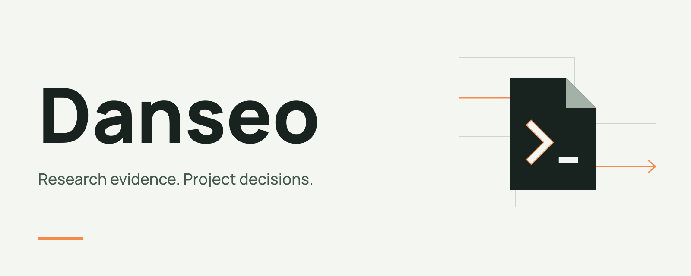

# Danseo

<picture>
  <source media="(prefers-color-scheme: dark) and (max-width: 640px)" srcset="assets/brand/banner-compact-dark.svg">
  <source media="(max-width: 640px)" srcset="assets/brand/banner-compact-light.svg">
  <source media="(prefers-color-scheme: dark)" srcset="assets/brand/banner-dark.svg">
  
</picture>

**Bring research evidence into project decisions.**

[](LICENSE)


[한국어 — default](README.md) · English · [Quick start](#quick-start) · [Guide](docs/CLI.en.md) · [Contributing](CONTRIBUTING.md)

Summary: Keep paper choices, sources, answers and comparison evidence in local files with your existing AI agent. A development preview with a CLI and a read-only research comparison view.

A summary alone rarely tells you enough to apply a paper. You need its evaluation conditions, exact source locations and a way to revisit earlier decisions in another chat.

Danseo (단서) means “clue” in Korean. It separates shared paper claims from project decisions, so several projects can reference the same evidence. [Name and identifiers](docs/NAMING.md)

## From finding papers to comparing evidence

| Step | What you keep |
| --- | --- |
| **Find and select** | Search rounds, stable numbers, and each selection's source, edition and reason |
| **Collect sources** | Managed PDF copies or existing-file links, identity and edition checks, and preprint consent |
| **Analyze and resume** | Shared Paper cards, topic-specific Markdown answers and notes, follow-up questions and reading positions |
| **Compare research** | Claims with current source-support reviews, conditions, limits, source locations and AI reasons |

Select a paper or criterion in `topic compare` to return to its PDF and analysis document. Source relationships and AI proposals stay distinct; changed or missing evidence is held back. [Comparison reference](docs/RESEARCH_COMPARISON.md)

**Your agent performs search, downloads, reading and comparison-criteria writing.** Danseo connects those records; it has no built-in LLM or automatic summarizer. Comparison requires agent-prepared Paper cards, claim-review files and `comparison.json`.

## Quick start

Requires **Node.js 22 or 24 LTS and npm**; use the latest 24.x patch for a new installation. Clone the public repository or use Download ZIP to get the source. There is no npm registry release; do not install an unrelated package with the same name.

Run inside the source directory:

```sh
npm ci
npm run build
node ./dist/cli.js validate --workspace ./examples/minimal --json
```

The synthetic example reports `ok: true`, 3 records, 2 projects and an expected draft warning. Validation checks structure and references. [Runtime support](docs/RUNTIME_SUPPORT.md)

### Start with your own question

Give an AI agent with file and shell access the absolute Danseo directory and a private topic directory. Finding papers also requires the agent's search tools.

```text
Read skills/danseo/SKILL.md in this Danseo directory.
Find papers for my research question using my private topic directory.
Show sources, editions and recommendation reasons so I can choose.
```

1. Choose candidates, then ask **“Collect the sources I chose”** in the same directory.
2. Ask **“Read paper 1 and answer this question”** to preserve answers and source locations.
3. Ask **“Compare these papers using the evidence checked so far”** to prepare criteria and the view.

In a new chat, supply the same tool, skill and topic directory. The [English workflow guide](docs/CLI.en.md#find-collect-analyze-and-compare) covers all four steps. The bundled skill, UI and some diagnostics are in Korean.

<details>
<summary><strong>Connect existing cards and projects</strong></summary>

Paper records describe claims and sources; Application records describe project decisions. Register explicit paths using the [synthetic workspace](examples/minimal/workspace.json), then give your agent the [four connection values](docs/CLI.en.md#connect-your-own-workspace).

`validate` checks structure and references; `list`/`show` read cards; `export` emits the current question and linked cards as Markdown or JSON. Original content, comments, extension fields and source locations are preserved. `--out` creates a new file only.

```sh
node ./dist/cli.js export --workspace ./examples/minimal --project demo --application app-demo --include-drafts --format markdown
```

The fixture is a draft, so it requires `--include-drafts`. This flag does not change review status. [Card model](docs/CARD_MODEL.md)

</details>

## Local files, explicit decisions

- Keep private PDFs, topic records and cards outside the product source. Exports include full card content and absolute paths; inspect them before sharing.
- No model key, database or permanent server is required. The CLI makes no outbound requests; only the comparison view starts a local read-only server, stopped with Ctrl+C. Agent search, downloads and model transmission follow that agent's settings and permissions.
- Keep author claims, AI interpretations, project observations and adoption decisions separate. Structural validation and source-support reviews do not certify reproducibility or user understanding.

## Documentation

| Start here | Contents |
| --- | --- |
| [English guide](docs/CLI.en.md) · [Korean CLI](docs/CLI.md) | Installation, topic workflow, workspaces and agent setup |
| [Analysis and resume](docs/PAPER_ANALYSIS.md) · [Research comparison](docs/RESEARCH_COMPARISON.md) | Paper-specific answers, criteria and source links |
| [Agent skill](skills/danseo/SKILL.md) · [Compatibility](docs/AGENT_COMPATIBILITY.md) | Evidence reading and tested integration scope |
| [Documentation index](docs/README.md) · [Release preparation](docs/OPEN_SOURCE.md) | Models, design, verification and candidate scope |

## Development status

`0.1.0-dev.1` is a development preview; the CLI and file formats may change. The candidate covers find, collect, analyze, compare and existing card exports. The card editor, separate learning-HTML skill, autonomous experiments, site submissions and MCP server are not included. The research comparison web app targets desktop. Standalone paper-relation HTML provides desktop and mobile layouts, short labels, topic groups and focused connections by default, with evidence and relation filters. Topic groups are editorial interpretations, not source claims.

Automated and installed-package checks are separate from human usage and learning-effect evaluation. [Runtime evidence](docs/RUNTIME_SUPPORT.md) · [Tasks](TASKS.md)

## Contributing and license

Bug reproductions, clearer guides, synthetic examples and platform reports are welcome. Read [CONTRIBUTING](CONTRIBUTING.md) and [SECURITY](SECURITY.md); do not attach private research or model logs to public reports.

Code, documentation, skill and synthetic examples use the [MIT License](LICENSE). Papers, datasets and user material retain their own terms. [Third-party notices](THIRD_PARTY_NOTICES.md) · [Brand assets](assets/brand/README.md)
