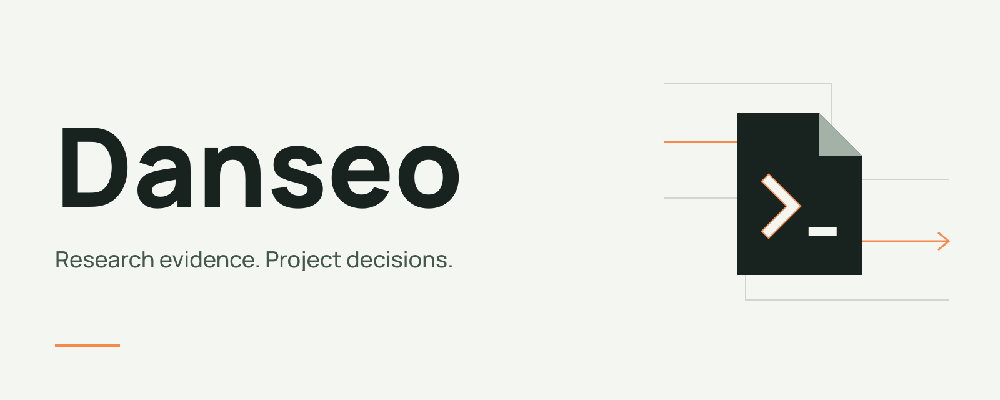
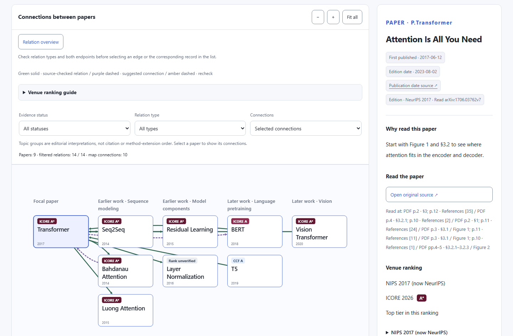

<div align="center">

<h1>Danseo</h1>

<picture>
  <source media="(prefers-color-scheme: dark) and (max-width: 640px)" srcset="assets/brand/banner-compact-dark.svg">
  <source media="(max-width: 640px)" srcset="assets/brand/banner-compact-light.svg">
  <source media="(prefers-color-scheme: dark)" srcset="assets/brand/banner-dark.svg">
  
</picture>

[](LICENSE)


한국어 · [English](README.md) · [스킬 설치](#skill-설치) · [지도 만들기](#논문-그래프-생성-요청) · [CLI 빠른 시작](#빠른-시작) · [문서](docs/README.ko.md) · [기여하기](CONTRIBUTING.md)

</div>

Danseo는 AI 에이전트로 찾은 논문을 지도에 보여 줍니다. 논문을 누르면 읽을 이유를, 연결을 누르면 근거가 된 원문 위치를 볼 수 있습니다. 검색과 읽기를 다음 채팅에서 이어갈 때는 CLI로 주제 폴더에 기록하세요.

## 논문 지도 미리 보기



*Attention Is All You Need*를 고르면 오른쪽에 읽을 이유와 원문에서 볼 곳이 나옵니다. 초록 실선은 원문에서 확인한 관계입니다. 점선은 AI가 제안했거나 원문 확인이 더 필요한 연결을 뜻합니다. [이미지 크게 보기](assets/readme/paper-graph-preview.png)

- **논문을 지도에서 보고 싶다면** [스킬 설치](#skill-설치)부터 시작하세요.
- **검색과 메모를 다음 채팅에서 이어가려면** [CLI 빠른 시작](#빠른-시작)으로 가세요.

<a id="skill-설치"></a>

## 스킬 설치

**Node.js 24.x 또는 22.x LTS**가 필요합니다. 로그인한 AI 에이전트가 내 컴퓨터의 파일을 읽고 셸 명령을 실행할 수 있어야 합니다. 논문 제목에서 시작하려면 에이전트가 웹에서 논문을 찾고 출처를 열 수 있어야 하고, 이미 가진 논문으로 만들려면 로컬 PDF를 읽을 수 있어야 합니다.

지도 스킬은 복사한 폴더에서 바로 실행됩니다. npm 설치, 빌드, 서버가 필요 없습니다.

### 1. 소스 내려받기

Git이 있다면 터미널에서 실행하세요.

```sh
git clone https://github.com/OstenHun/danseo.git
cd danseo
node --version
```

GitHub에서 **Code → Download ZIP**으로 받아도 됩니다. 압축을 풀고 `README.md`와 `skills/`가 보이는 폴더에서 터미널을 연 뒤 `node --version`을 실행하세요. `v24.`나 `v22.`로 시작하는 버전이 나와야 합니다.

### 2. 에이전트와 운영체제 고르기

내려받은 소스 폴더에서 운영체제에 맞는 블록을 실행하고, 쓰는 에이전트에 맞는 값을 입력하세요. 스킬 폴더 전체를 홈 폴더로 복사하므로 어느 프로젝트에서든 Danseo를 쓸 수 있습니다.

- [Codex](https://developers.openai.com/codex/skills/)는 `codex`
- [Claude Code](https://code.claude.com/docs/en/skills)는 `claude`
- [Antigravity CLI](https://antigravity.google/docs/skills/)는 `agy`

<details>
<summary><strong>Windows · PowerShell</strong></summary>

```powershell
& {
    $danseoHost = Read-Host 'codex, claude, agy 중 하나를 입력하세요'
    $danseoLocations = @{
        codex  = '.agents/skills/danseo'
        claude = '.claude/skills/danseo'
        agy    = '.gemini/config/skills/danseo'
    }
    if (-not $danseoLocations.ContainsKey($danseoHost)) { throw 'codex, claude, agy 중 하나를 입력하세요.' }

    $danseoTarget = Join-Path $HOME $danseoLocations[$danseoHost]
    if (Test-Path -LiteralPath $danseoTarget) { throw "이미 설치되어 있습니다: $danseoTarget" }
    New-Item -ItemType Directory -Force -Path (Split-Path $danseoTarget -Parent) -ErrorAction Stop | Out-Null
    Copy-Item -LiteralPath './skills/danseo' -Destination $danseoTarget -Recurse -ErrorAction Stop
    Write-Output "Danseo 설치 위치: $danseoTarget"
}
```

</details>

<details>
<summary><strong>macOS·Linux · Bash 또는 Zsh</strong></summary>

```sh
{
  printf 'codex, claude, agy 중 하나를 입력하세요: '
  read -r danseohost
  case "$danseohost" in
    codex)  danseotarget="$HOME/.agents/skills/danseo" ;;
    claude) danseotarget="$HOME/.claude/skills/danseo" ;;
    agy)    danseotarget="$HOME/.gemini/config/skills/danseo" ;;
    *)      danseotarget='' ;;
  esac

  if [ -z "$danseotarget" ]; then
    printf '%s\n' 'codex, claude, agy 중 하나를 입력하세요.'
  elif [ -e "$danseotarget" ] || [ -L "$danseotarget" ]; then
    printf '이미 설치되어 있습니다: %s\n' "$danseotarget"
  else
    mkdir -p "$(dirname "$danseotarget")" &&
      cp -R ./skills/danseo "$danseotarget" &&
      printf 'Danseo 설치 위치: %s\n' "$danseotarget"
  fi
}
```

</details>

설치가 끝나면 `Danseo 설치 위치:` 뒤에 스킬 폴더 경로가 나옵니다. 복사한 폴더가 동작하는지 보려면 아래 명령의 `<설치 경로>`를 그 경로로 바꿔 실행하고 `fail 0`을 확인하세요.

```sh
node --test "<설치 경로>/scripts/research-evidence.test.mjs"
```

이미 Danseo를 설치했다면 에이전트가 어느 복사본을 읽는지 먼저 확인하세요. 업데이트할 때는 기존 복사본을 에이전트의 스킬 폴더 밖으로 옮겨 백업한 뒤 위 복사 명령을 다시 실행합니다.

## 논문 그래프 생성 요청

### 3. 첫 지도 만들고 열기

에이전트가 파일을 저장할 수 있는 폴더에서 새 채팅을 열고 이렇게 요청해 보세요.

> Attention Is All You Need를 읽으려고 해. 관련 있는 선행·후속 논문을 찾아 한국어로 논문 지도를 만들어 줘. 각 논문을 읽을 이유와 확인한 출처를 남기고, 최초 공개일과 지도에서 다룬 판본의 날짜도 확인할 수 있으면 넣어 줘. 이 폴더에 `attention-paper-graph.html`로 저장하고 파일 위치를 알려 줘.

에이전트가 Danseo를 고르지 않으면 Codex에서는 스킬 선택 메뉴를 쓰거나 메시지를 `$danseo`로 시작하세요. Claude Code와 Antigravity CLI에서는 메시지를 `/danseo`로 시작합니다.

Danseo가 보이지 않으면 에이전트를 다시 시작하고, 설치 폴더에 `SKILL.md`, `scripts/`, `references/`, `assets/`가 모두 있는지 확인하세요. 설치한 `SKILL.md`의 절대 경로를 알려 주고 그 스킬을 쓰라고 요청해도 됩니다.

개념부터 살펴볼 때는 “Danseo로 어텐션을 알아보고 싶어”라고 요청해 보세요. Danseo가 대표 논문을 고르고, 핵심 개념과 배경 논문, 원문에서 확인한 논문 간 관계를 첫 지도에 함께 담습니다.

이미 PDF를 모아 뒀다면 아래처럼 폴더를 알려 주세요. 예시 경로는 에이전트가 읽고 쓸 수 있는 실제 절대 경로로 바꾸면 됩니다.

> `C:/research/my-topic/papers`에 있는 논문을 읽고, 논문 사이의 관계를 HTML 지도로 만들어 줘. 각 논문이 검색 결과에서 찾은 근거를 답변에 어떻게 쓰고 평가하는지 보고 싶어. 결과는 `C:/research/my-topic/output`에 저장해 줘.

macOS에서는 `/Users/me/research/my-topic/papers`, Linux에서는 `/home/me/research/my-topic/papers`처럼 경로를 적습니다. PDF를 더 찾아 달라고 할 때는 에이전트에 검색과 다운로드 권한도 필요합니다.

저장한 HTML을 데스크톱 브라우저에서 열어 보세요. 짧은 이름이 붙은 논문을 누르면 전체 제목과 읽을 이유를 볼 수 있습니다. 연결을 누르면 확인한 페이지나 절이 나옵니다. 처음에는 선택한 논문의 연결이 보이고, 필요하면 전체 연결을 켜거나 근거 상태와 관계 종류로 걸러 볼 수 있습니다. 지도에서 논문을 묶는 방식은 읽기 편하도록 에이전트가 정한 분류입니다.

최초 공개일을 확인한 논문은 지도에 연도가 표시됩니다. 논문 상세에서 정확한 날짜와 출처를 볼 수 있고, 읽을 판본의 날짜를 확인했다면 함께 표시합니다. 게재처 등급도 확인된 범위에서 보여 줍니다. 등급이 여러 개라면 상세에서 다른 등급과 그 출처를 펼쳐 볼 수 있습니다.

스킬은 원문과 판본을 확인한 뒤 근거를 붙이고, 개요와 자료에 나온 수량을 검사해 HTML을 만듭니다. 원문에서 확인한 관계와 AI가 제안한 연결은 지도와 상세에서 구분합니다. 같은 자료로 다시 만들거나 수정할 수 있도록 HTML과 함께 후보 JSON과 근거 파일을 보관하세요.

자동 검사는 입력의 구조와 근거 파일, 수치 표기를 확인합니다. 논문 사이의 관계를 제대로 해석했는지는 원문과 대조해야 합니다. 검사가 실패하면 원문과 입력을 확인한 뒤 다시 실행하세요. 에이전트가 브라우저를 쓸 수 없다면 화면에서 어디까지 확인했는지도 물어보세요. [원문 확인 절차](skills/danseo/references/relation-verification.md) · [자동 검사 범위](skills/danseo/references/evidence-gate.md)

이미 만든 지도를 다시 확인할 때는 다음처럼 요청할 수 있습니다.

> `C:/research/my-topic/output`에 이전에 만든 자료가 있어. 후보 JSON과 근거 파일을 원문 PDF와 다시 대조해 줘. 원문에서 확인한 관계와 AI 제안이 섞였거나 기록·문서·쌍의 수가 다르면 고쳐 줘. 기존 파일은 그대로 두고 새 HTML로 저장해 줘. 화면에서 확인한 것도 알려 줘.

### 보조 스킬과 결과 언어

배포하는 스킬 안내와 설정, 기본 지도 예제는 영어입니다. 설명과 생성 결과에 쓸 언어는 요청할 때 정하면 됩니다.

- [`danseo-reading`](skills/danseo-reading/SKILL.md)은 논문에 대해 질문하고, 원문을 근거로 답을 확인하거나 개념 지도를 보는 데 씁니다.
- [`paper-to-project`](skills/paper-to-project/SKILL.md)는 논문의 실험 조건을 내 프로젝트와 비교하고 적용 여부를 판단할 때 씁니다.

보조 스킬을 설치하려면 위 설치 예시의 원본과 대상에서 폴더 이름을 원하는 스킬 이름으로 바꾼 뒤 폴더 전체를 복사하세요. 학습 지도를 만드는 데는 Node.js 22 또는 24가 필요합니다. 프로젝트에 적용할지를 판단하는 스킬은 지침만 담고 있습니다.

논문 지도와 학습 HTML의 메뉴를 한국어로 표시하려면 `language`를 `ko`로, 영어로 표시하려면 `en`으로 지정하세요. 이 값이 없는 기존 입력은 논문 지도가 영어, 학습 화면이 한국어입니다. 그 밖의 언어는 본문에 쓸 수 있고 메뉴는 영어로 표시합니다. 저장한 HTML에 바뀐 언어를 적용하려면 다시 생성해야 합니다. CLI와 비교 화면의 메뉴는 영어입니다.

## 빠른 시작

### 전체 CLI로 주제·카드 관리하기

검색 내역이나 논문 메모를 다음 채팅에서도 이어가고 싶다면 CLI를 준비하세요. CLI로 논문을 기록한 Paper 카드와 프로젝트별 적용 결과도 관리할 수 있습니다. 지도만 만들려면 위에서 설치한 스킬을 쓰면 됩니다.

**Node.js 22 또는 24 LTS와 npm**이 필요합니다. 새로 설치한다면 Node.js 24의 최신 패치를 권장합니다. [내려받은 소스](#1-소스-내려받기)로 설치하세요. Danseo는 아직 npm에 게시되지 않았습니다.

내려받은 소스 폴더에서 아래 명령을 실행합니다.

```sh
npm ci
npm run build
node ./dist/cli.js validate --workspace ./examples/minimal --json
```

예제에서 `ok: true`와 기록 3개, 프로젝트 2개가 나오면 파일 구조와 참조 검사에 성공한 겁니다. 예제에 초안 카드가 있어 `draft` 경고도 함께 나옵니다. [지원 환경](docs/RUNTIME_SUPPORT.md)

### 내 주제로 시작하기

명령과 웹 검색을 쓸 수 있는 에이전트에 CLI를 설치한 Danseo 폴더의 절대 경로와 검색 내역을 저장할 주제 폴더를 알려 주세요. 처음 시작한다면 [논문 찾기와 원문 모으기](docs/CLI.md#주제-채팅에서-논문-찾기)를 따라 연구 질문을 적고 주제 폴더를 만듭니다.

이미 검색한 주제라면 새 채팅에서 같은 폴더를 열고 이렇게 요청해 보세요.

> 이 주제 폴더에 적힌 질문에 맞는 논문을 더 찾아서 다음 검색 회차에 저장해 줘. 전에 고른 논문은 그대로 두고 새 후보의 출처, 판본, 추천 이유를 알려 줘.

1. 후보를 고른 뒤 같은 폴더에서 “고른 논문 원문을 모아 줘”라고 요청합니다.
2. “1번 논문을 읽고 이 질문에 답해 줘”라고 하면 답과 원문 위치를 남길 수 있습니다.
3. “확인한 근거로 두 논문을 비교해 줘”라고 요청해 비교 기준과 화면을 준비합니다.

지난 검색과 선택은 폴더에 남습니다. 새 채팅에서 에이전트가 CLI를 찾지 못하면 설치 경로를 함께 알려 주세요. [읽다 만 논문 이어서 보기](docs/PAPER_ANALYSIS.md) · [논문 비교하기](docs/RESEARCH_COMPARISON.md)

<details>
<summary><strong>이미 있는 카드와 프로젝트에 연결하기</strong></summary>

Paper에는 논문의 주장과 출처를 기록하고, Application에는 그 근거를 내 프로젝트에 적용할지 적습니다. [예제 workspace](examples/minimal/workspace.json)처럼 카드와 프로젝트를 등록한 뒤 [CLI 첫 실행](docs/CLI.md#첫-실행)에 나온 연결 정보 네 가지를 에이전트에 알려 주세요.

`validate`로 구조와 참조를 검사하고, `list`나 `show`로 카드를 확인할 수 있습니다. `export`는 현재 질문과 관련 카드 전문을 Markdown이나 JSON으로 내보냅니다. 카드 본문, 주석, 확장 필드와 원문 위치까지 담고, `--out`을 지정하면 새 파일에만 저장합니다.

```sh
node ./dist/cli.js export --workspace ./examples/minimal --project demo --application app-demo --include-drafts --format markdown
```

예제에는 초안이 들어 있어 `--include-drafts`를 붙였습니다. 내보낸 뒤에도 카드의 검토 상태는 그대로입니다. [카드 모델](docs/CARD_MODEL.md)

</details>

## 논문을 찾는 순간부터 비교할 때까지

| 하는 일 | 남기는 기록 |
| --- | --- |
| 논문 찾기 | 검색 회차와 논문 번호, 선택할 때 확인한 출처·판본·추천 이유 |
| 원문 모으기 | 저장한 PDF 사본이나 기존 파일의 경로, 제목·저자·판본을 확인한 결과와 초고 사용 동의 |
| 읽고 메모하기 | Paper 카드, 주제별 Markdown 답변과 메모, 이어서 읽을 곳과 후속 질문 |
| 논문 비교하기 | 원문에서 근거를 확인한 주장, 평가 조건과 한계, 원문 위치, AI가 비교 기준을 제안한 이유 |

논문 검색, 다운로드, 읽기, 비교 기준 작성은 에이전트가 맡습니다. Danseo에 남긴 Paper 카드와 원문 근거는 다른 프로젝트에서도 다시 쓸 수 있습니다.

`topic compare`로 비교 화면을 열어 보세요. 논문이나 비교 항목을 누르면 PDF와 분석 문서를 열 수 있습니다. 원문을 확인한 관계와 AI 제안은 화면에서 구분합니다. 근거가 바뀌거나 없어지면 비교에서 보류합니다. 비교를 열기 전에 Paper 카드와 주장별 검토, `comparison.json`을 준비합니다. [비교 화면 사용법](docs/RESEARCH_COMPARISON.md)

## 내 자료와 판단은 로컬에

- 개인 PDF, 주제 기록, 카드는 소스 코드와 다른 폴더에 보관하세요. 내보낸 파일에는 카드 전문과 내 컴퓨터의 절대 경로가 담기므로 공유하기 전에 살펴보세요.
- CLI 자체는 모델 키나 DB 없이 로컬에서 동작하며 외부로 요청을 보내지 않습니다. 비교 화면을 열 때만 읽기 전용 서버를 실행하며, 터미널에서 `Ctrl+C`를 누르면 끝납니다. 에이전트가 웹에서 검색하거나 파일을 받거나 자료를 모델에 보낼 때는 그 도구의 권한과 설정이 적용됩니다.
- 저자의 주장, AI의 해석, 프로젝트에서 관찰한 결과, 실제 채택 결정은 따로 기록합니다. 구조 검사와 원문 대조를 마친 뒤에도 결과를 재현할 수 있는지, 내가 논문을 이해했는지는 각각 확인해야 합니다.

## 프로젝트 구조

Danseo는 TypeScript/Node.js 패키지와 에이전트용 스킬로 이루어져 있습니다. 주제 폴더에는 연구 질문 하나를 위해 고른 논문, 모은 원문, 메모가 남습니다. 별도의 `workspace.json`에는 여러 프로젝트에서 다시 쓰는 Paper 기록과 프로젝트별 Application 기록을 등록합니다. 그래서 여러 프로젝트가 같은 근거를 인용하면서도 각자 다른 판단을 내릴 수 있습니다.

```text
src/                     CLI, 파일 기반 core, 비교 서버와 브라우저 화면
schemas/                 카드, workspace, 관계 스키마
skills/                  논문 지도, 논문 학습, 프로젝트 적용
examples/minimal/        검증과 내보내기용 합성 workspace
tests/                   CLI, 원문, 패키지 검사
docs/                    사용 안내, 데이터 형식, 개발 참고 자료
```

## 문서

| 시작할 곳 | 내용 |
| --- | --- |
| [CLI 안내](docs/CLI.md) · [시작하기](docs/CLI.en.md) | 설치와 주제별 흐름 |
| [분석](docs/PAPER_ANALYSIS.md) · [비교](docs/RESEARCH_COMPARISON.md) | 논문 답변과 원문 근거 |
| [스킬](skills/danseo/SKILL.md) · [에이전트 연결](docs/AGENT_COMPATIBILITY.md) | 근거 읽는 법과 연결에 필요한 설정 |
| [문서 목록](docs/README.ko.md) · [공개 범위](docs/OPEN_SOURCE.md) | 데이터 형식과 공유 조건 |

## 개발 상태

`0.1.0-dev.1` 개발 프리뷰입니다. CLI와 파일 형식은 바뀔 수 있습니다. 지금은 논문을 찾고 모아 읽은 뒤 비교하거나 기존 카드를 내보낼 수 있습니다. 학습과 프로젝트 적용 스킬은 따로 설치합니다. 카드 편집기, 자동 실험, 사이트 제출, MCP 서버는 아직 지원 범위에 없습니다.

비교 화면과 논문 지도는 PC나 노트북을 기준으로 만들었습니다. 지원 환경 문서에서 직접 실행해 본 환경과 자동 검사 범위를 볼 수 있습니다. 실제 사용과 학습에 얼마나 도움이 되는지는 별도로 확인해야 합니다. [지원 환경](docs/RUNTIME_SUPPORT.md) · [현재 범위와 후속 작업](TASKS.md)

## 기여와 라이선스

막힌 곳이 있으면 사용 환경, 실행한 명령, 실제로 나온 결과를 [GitHub 이슈](https://github.com/OstenHun/danseo/issues)에 남겨 주세요. 더 쉬운 설명, 예제, 다른 환경에서 실행해 본 결과도 도움이 됩니다. [기여 안내](CONTRIBUTING.md)와 [보안 안내](SECURITY.md)를 먼저 읽고, 공개 예제는 개인 논문이나 연구 노트, 모델 로그가 들어 있지 않은 자료로 만들어 주세요.

코드, 문서, 스킬, 합성 예제에는 [MIT 라이선스](LICENSE)를 적용합니다. 외부 논문, 데이터, 사용자가 만든 자료의 권리는 각 원저작자에게 있습니다. [외부 의존성 고지](THIRD_PARTY_NOTICES.md) · [브랜드 자료](assets/brand/README.md)
