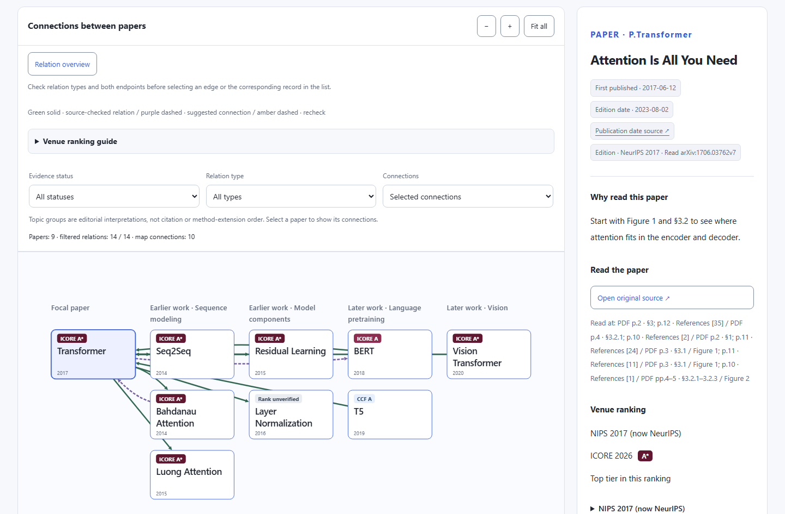

# Danseo

Summary: Use your AI agent to map how papers connect and where to read the evidence. Add the optional CLI to save and compare evidence across a research topic.

[](LICENSE)


[한국어](README.ko.md) · [Install the skill](#install-the-skill) · [CLI quick start](#quick-start) · [Documentation](docs/README.md)

## See a paper graph



Select a connection to see which paper cites the other, why the citation matters, and where to find the supporting passage. Danseo saves the graph as an HTML file you can open in a desktop browser. [View the full-size screenshot of the synthetic example](assets/readme/paper-graph-preview.png).

- [Install the Danseo skill](#install-the-skill) to make a graph in Codex, Claude Code, or Antigravity CLI.
- [Build the CLI](#quick-start) to save a research topic and compare papers across sessions.

<a id="skill-설치"></a>

## Install the skill

You need [Node.js](https://nodejs.org/en/download) **24.x or 22.x LTS** and a signed-in local AI agent that can read files and run shell commands. To start from a paper title, the agent also needs to be able to find papers online and open their sources. For papers you already have, give the agent access to the local PDFs.

The graph skill runs directly from its copied folder, with no npm install, build, or server.

### 1. Download the source

If you have Git, run these commands in a terminal:

```sh
git clone https://github.com/OstenHun/danseo.git
cd danseo
node --version
```

You can also use **Code → Download ZIP** on GitHub. Extract the ZIP, open a terminal in the folder containing `README.md` and `skills/`, and run `node --version`. You should see a version starting with `v24.` or `v22.`.

### 2. Choose your agent and operating system

From the downloaded source folder, run the block for your operating system and enter the choice shown for your agent. The commands copy the complete skill folder to your home directory so Danseo is available across projects.

- For [Codex](https://developers.openai.com/codex/skills/), enter `codex`. In a new chat, choose Danseo in the skill picker or type `$danseo`.
- For [Claude Code](https://code.claude.com/docs/en/skills), enter `claude`. In a new chat, type `/danseo`.
- For [Antigravity CLI](https://antigravity.google/docs/skills/), enter `agy`. Start a new conversation in the interactive CLI, then type `/danseo`.

<details>
<summary><strong>Windows · PowerShell</strong></summary>

```powershell
& {
    $danseoHost = Read-Host 'Choose codex, claude, or agy'
    $danseoLocations = @{
        codex  = '.agents/skills/danseo'
        claude = '.claude/skills/danseo'
        agy    = '.gemini/config/skills/danseo'
    }
    if (-not $danseoLocations.ContainsKey($danseoHost)) { throw 'Enter codex, claude, or agy.' }

    $danseoTarget = Join-Path $HOME $danseoLocations[$danseoHost]
    if (Test-Path -LiteralPath $danseoTarget) { throw "Danseo is already installed at $danseoTarget" }
    New-Item -ItemType Directory -Force -Path (Split-Path $danseoTarget -Parent) -ErrorAction Stop | Out-Null
    Copy-Item -LiteralPath './skills/danseo' -Destination $danseoTarget -Recurse -ErrorAction Stop
    Write-Output "Installed Danseo at $danseoTarget"
}
```

</details>

<details>
<summary><strong>macOS or Linux · Bash or Zsh</strong></summary>

```sh
{
  printf 'Choose codex, claude, or agy: '
  read -r danseohost
  case "$danseohost" in
    codex)  danseotarget="$HOME/.agents/skills/danseo" ;;
    claude) danseotarget="$HOME/.claude/skills/danseo" ;;
    agy)    danseotarget="$HOME/.gemini/config/skills/danseo" ;;
    *)      danseotarget='' ;;
  esac

  if [ -z "$danseotarget" ]; then
    printf '%s\n' 'Enter codex, claude, or agy.'
  elif [ -e "$danseotarget" ] || [ -L "$danseotarget" ]; then
    printf 'Danseo is already installed at %s\n' "$danseotarget"
  else
    mkdir -p "$(dirname "$danseotarget")" &&
      cp -R ./skills/danseo "$danseotarget" &&
      printf 'Installed Danseo at %s\n' "$danseotarget"
  fi
}
```

</details>

If you already have Danseo installed, check which copy your agent loads. To update, move that copy to a backup location outside the agent's skill folders and run the copy instructions again. Antigravity CLI users who want to choose an Argon model can see the available models with `agy models`.

<a id="논문-그래프-생성-요청"></a>

## Generate a paper-relationship graph

### 3. Create and open your first graph

Open a folder where your agent can save files. Start a new chat in that folder, invoke Danseo as shown above, then send this prompt:

```text
I want to read Attention Is All You Need. Use Danseo to find a few related
papers from before and after it. Create an interactive HTML graph in English
and save it as attention-paper-graph.html in this folder. Show where the
sources support each connection. Give me the path to the HTML file.
```

Open the returned `.html` file in a desktop browser. Select a paper to see its reading locations, or select a connection to see what links the papers and where to check the evidence.

When your agent can verify a venue and its rank, the graph shows a badge and a venue ranking guide. Paper details show the ranking edition and sources, plus the subject category for JCR when available. The guide explains ICORE conference ranks, JCR journal quartiles, and Norwegian Register levels on their own scales.

If the agent can't access online sources, give it absolute paths to two or more local PDFs it can read. Ask for a graph using those files and have it report any connections it could not check. Review your agent's file permissions and provider settings before sharing private PDFs.

If Danseo doesn't appear, restart your agent and check that the installed folder contains `SKILL.md`, `scripts/`, `references/`, and `assets/`. You can also give the agent the absolute path to the installed `SKILL.md` and ask it to use that skill.

For more ways to start, see [paper-reading orientation](skills/danseo/references/paper-orientation.md) and the [Danseo skill guide](skills/danseo/README.md).

<a id="빠른-시작"></a>

## Quick start

### Build and try the CLI

The CLI saves paper selections, source files or links, answers and notes, and evidence for comparisons. It runs independently of skill installation. Use Node.js **24.x or 22.x LTS** with npm. From the [downloaded source folder](#1-download-the-source), run:

```sh
npm ci
npm run build
node ./dist/cli.js validate --workspace ./examples/minimal --json
```

The first command fetches the locked dependencies. After the build, the example should report `ok: true`, three records, two projects, and one expected draft warning. These checks cover file structure and references. The example uses synthetic cards with Korean body text. The CLI messages are in English.

For your own research, follow the [CLI and agent guide](docs/CLI.en.md#find-collect-analyze-and-compare) to create a topic folder, collect sources, and open a local comparison. For reusable Paper and Application cards, see [connect your own workspace](docs/CLI.en.md#connect-your-own-workspace).

### Companion skills and output language

- [`danseo-reading`](skills/danseo-reading/SKILL.md) helps you ask questions about a paper and explore its concepts. Its view generator needs Node.js.
- [`paper-to-project`](skills/paper-to-project/SKILL.md) guides you through comparing a paper's conditions with your project. It needs no Node.js runtime.

To add a companion skill, use the copy instructions above with the companion's folder name in the source path and each destination path. Start a new chat and invoke it by that name.

Ask for the language you want in the prompt. Standalone graph and learning views have English and Korean controls. They preserve original paper titles and quotations. The CLI and its comparison viewer have English controls. See [output-language rules](skills/danseo/SKILL.md#output-language).

## Project structure

Danseo is a TypeScript/Node.js package with portable agent skills. A topic folder keeps the selected papers, collected sources, and notes for one research question. A separate `workspace.json` registers reusable Paper records and project-specific Application records. Several projects can cite the same evidence while making different decisions about it.

```text
src/                     CLI, file-based core, comparison server and browser UI
schemas/                 Card, workspace, and relationship schemas
skills/                  Research graphs, paper learning, and project application
examples/minimal/        Synthetic workspace for validation and export
tests/                   CLI, source and package checks
docs/                    Usage guides, data formats and development references
```

Keep private papers and records outside the source repository. Exports can include full card text and absolute local paths, so review them before sharing.

## Status and limitations

Danseo is a development preview. The CLI and file formats may change. Build the CLI from source. The read-only comparison viewer runs locally in a desktop browser. Stop its server with Ctrl+C. Your agent handles web search and source access under its own permissions.

Source checks cover the displayed evidence. Results depend on which sources the agent can read, and scientific reproduction is a separate step. See [runtime support](docs/RUNTIME_SUPPORT.md), [current scope](TASKS.md), and [distribution](docs/OPEN_SOURCE.md).

## Documentation

| Goal | Start here |
| --- | --- |
| Generate a paper graph | [First graph](#generate-a-paper-relationship-graph) · [Skill guide](skills/danseo/README.md) |
| Find, collect, analyze, and compare papers | [CLI and agent guide](docs/CLI.en.md) |
| Look up file formats and workflows | [Documentation index](docs/README.md) |
| Use the logos and banners | [Brand assets](assets/brand/README.md) |

## Contributing and license

Bug reproductions, clearer documentation, synthetic examples, and reports from other environments are welcome. See [contributing](CONTRIBUTING.md) and [security](SECURITY.md). Keep private papers, research notes, and model logs out of public reports.

Code, documentation, skills, and synthetic examples use the [MIT License](LICENSE). Papers, datasets, and user-supplied material retain their own terms. See [third-party notices](THIRD_PARTY_NOTICES.md).
