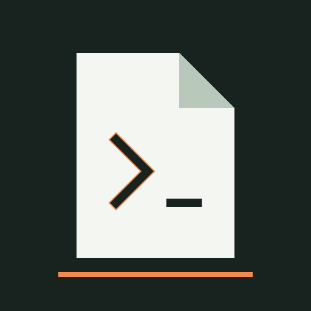
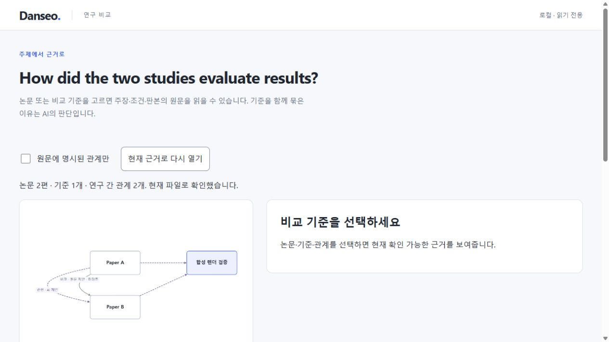

<p align="center">
  
</p>

<h1 align="center">Danseo</h1>

<p align="center">
  <strong>논문의 근거를, 내 프로젝트의 판단으로.</strong><br>
  Research evidence. Project decisions.
</p>

<p align="center">
  <a href="LICENSE"></a>
  
  
</p>

<p align="center">
  <strong>한국어</strong> · <a href="README.en.md">English</a> · <a href="#빠른-시작">빠른 시작</a> · <a href="docs/README.md">문서</a> · <a href="CONTRIBUTING.md">기여하기</a>
</p>

요약: 기존 AI 에이전트와 논문을 찾고, 고른 논문의 원문·답변·비교 근거를 로컬 파일로 연결한다. CLI와 읽기 전용 연구 비교 화면을 제공하는 개발 프리뷰다.

<p align="center">
  
  <br><sub>합성 데이터로 실행한 비교 화면입니다. 실제 논문이나 연구 결과가 아닙니다.</sub>
</p>

논문을 읽고 나면 결과가 나온 조건, 확인한 원문 위치, 내 프로젝트에 적용할 수 있는지를 다음 대화에서도 이어 볼 수 있어야 한다.

Danseo(단서)는 그 판단에 필요한 실마리를 남긴다. 논문 자체의 주장과 프로젝트별 적용 판단을 나누고, 같은 논문의 근거를 여러 프로젝트에서 참조한다. [이름과 표기](docs/NAMING.md)

## 논문을 찾는 순간부터 비교할 때까지

| 단계 | 남기는 기록 |
| --- | --- |
| **탐색·선택** | 검색 회차와 고정 번호, 고를 당시의 출처·판본·추천 이유 |
| **원문 수집** | PDF 관리 사본 또는 기존 파일 연결, 제목·저자·판본 확인과 초고 사용 동의 |
| **분석·재개** | 공통 Paper 카드와 주제별 Markdown 답변·메모, 후속 질문과 다음 읽을 위치 |
| **연구 비교** | 현재 원문과 대조해 지지를 확인한 주장, 평가 조건·한계·원문 위치와 AI 제안 이유 |

`topic compare`의 지도에서 논문이나 기준을 골라 PDF와 분석 문서를 열 수 있다. 원문에 명시된 관계와 AI 제안을 구분하고, 바뀌거나 없어진 근거는 보류한다. [비교 화면 사용법](docs/RESEARCH_COMPARISON.md)

**검색·다운로드·실제 독해·비교 기준 작성은 기존 에이전트가 맡는다.** Danseo는 그 기록을 파일로 연결하며, 자체 LLM이나 자동 논문 요약 서비스가 아니다. 비교에는 에이전트가 준비한 Paper 카드·주장별 검토·`comparison.json`이 필요하다.

## 빠른 시작

**Node.js 22 또는 24 LTS와 npm**이 필요하다. 새 설치에는 24의 최신 패치를 권장한다. 공개 저장소를 clone하거나 Download ZIP으로 소스를 내려받는다. npm에는 아직 게시하지 않았으므로 이름이 같은 외부 패키지를 설치하지 않는다.

내려받은 소스 폴더에서 실행한다.

```sh
npm ci
npm run build
node ./dist/cli.js validate --workspace ./examples/minimal --json
```

합성 예제는 `ok: true`, 기록 3개·프로젝트 2개와 `draft` 경고를 출력한다. 경고는 정상이며 검사는 구조·참조만 확인한다. [지원 환경](docs/RUNTIME_SUPPORT.md)

### 내 주제로 시작하기

파일을 읽고 명령을 실행할 수 있는 AI 에이전트에 Danseo 폴더의 절대 경로와 개인 주제 폴더를 알려준다. 논문 탐색에는 에이전트의 검색 기능도 필요하다.

```text
이 Danseo 폴더의 skills/danseo/SKILL.md를 읽고,
내 개인 주제 폴더에서 연구 질문에 맞는 논문을 찾아줘.
출처·판본·추천 이유를 보여주면 내가 고를게.
```

1. 후보를 고르고 같은 폴더에서 “고른 논문 원문을 모아줘”로 이어간다.
2. “1번 논문을 읽고 이 질문에 답해줘”로 답과 원문 위치를 남긴다.
3. “확인한 근거로 두 논문을 비교해줘”로 비교 기준과 화면을 준비한다.

새 채팅에서도 같은 도구·skill·주제 폴더를 알려준다. [탐색·수집](docs/CLI.md#주제-채팅에서-논문-찾기) → [분석·재개](docs/PAPER_ANALYSIS.md) → [비교](docs/RESEARCH_COMPARISON.md)

<details>
<summary><strong>이미 있는 카드와 프로젝트에 연결하기</strong></summary>

Paper는 논문의 주장과 출처를, Application은 프로젝트의 적용 판단을 기록한다. [합성 workspace](examples/minimal/workspace.json)처럼 카드와 프로젝트를 명시적으로 등록하고, [CLI 첫 실행](docs/CLI.md#첫-실행)의 네 연결값을 에이전트에 전달한다.

`validate`는 구조·참조를 검사하고, `list`/`show`는 카드를 조회한다. `export`는 현재 질문과 관련 카드 전문을 Markdown/JSON으로 내보낸다. 본문·주석·확장 필드와 원문 위치를 보존하며 `--out`은 새 파일만 만든다.

```sh
node ./dist/cli.js export --workspace ./examples/minimal --project demo --application app-demo --include-drafts --format markdown
```

합성 예제는 draft이므로 `--include-drafts`를 쓴다. 이 옵션은 검토 상태를 바꾸지 않는다. [카드 모델](docs/CARD_MODEL.md)

</details>

## 내 자료와 판단은 로컬에

- 개인 PDF·주제 기록·카드는 제품 소스와 분리해 보관한다. 내보낸 묶음에는 카드 전문과 로컬 절대 경로가 들어가므로 외부 공유 전에 확인한다.
- CLI에는 모델 키·DB·상시 서버가 필요하지 않으며 자체 외부 요청도 보내지 않는다. 비교 화면을 실행할 때만 로컬 읽기 전용 서버를 열고 Ctrl+C로 종료한다. 에이전트의 외부 검색·다운로드·모델 전송은 해당 도구의 설정과 권한을 따른다.
- 저자 주장·AI 해석·프로젝트 관찰·채택 결정을 구분한다. 구조 검사와 원문 지지 검토는 논문 재현이나 사용자 이해의 인증이 아니다.

## 문서

| 시작할 곳 | 내용 |
| --- | --- |
| [한국어 CLI](docs/CLI.md) · [English guide](docs/CLI.en.md) | 설치, 주제 흐름, workspace와 에이전트 연결 |
| [분석과 재개](docs/PAPER_ANALYSIS.md) · [연구 비교](docs/RESEARCH_COMPARISON.md) | 논문별 답변, 비교 기준과 원문 확인 |
| [Agent skill](skills/danseo/SKILL.md) · [호환성](docs/AGENT_COMPATIBILITY.md) | 근거 읽기와 도구별 확인 범위 |
| [문서 색인](docs/README.md) · [공개 준비](docs/OPEN_SOURCE.md) | 데이터 모델·설계, 검증 근거와 공개 범위 |

## 개발 상태

`0.1.0-dev.1` 개발 프리뷰다. CLI와 파일 형식은 바뀔 수 있다. 공개 후보에는 탐색·수집·분석·비교와 기존 카드 내보내기를 포함한다. 카드 편집기·별도 학습 HTML skill·자동 실험·사이트 제출·MCP 서버는 포함하지 않는다. 데스크톱용이며 모바일은 지원·검수 범위 밖이다.

자동 검사와 설치본 확인은 실제 사람의 사용·학습 효과와 구분한다. [런타임별 실행 근거](docs/RUNTIME_SUPPORT.md) · [실행 목록](TASKS.md)

## 기여와 라이선스

버그 재현, 더 쉬운 안내, 합성 예제와 다른 환경의 실행 결과를 환영한다. [기여 안내](CONTRIBUTING.md)와 [보안 안내](SECURITY.md)를 먼저 읽고, 개인 논문·연구 노트·모델 로그를 공개 첨부하지 않는다.

코드·문서·skill·합성 예제는 [MIT License](LICENSE)를 따른다. 외부 논문·데이터·사용자 자료의 권리는 원저작자에게 남는다. [외부 의존성 고지](THIRD_PARTY_NOTICES.md) · [브랜드 자료](assets/brand/README.md)
